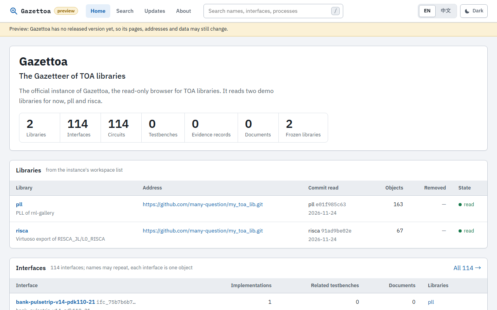
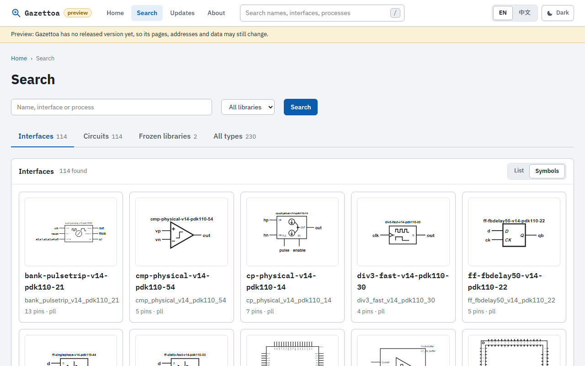
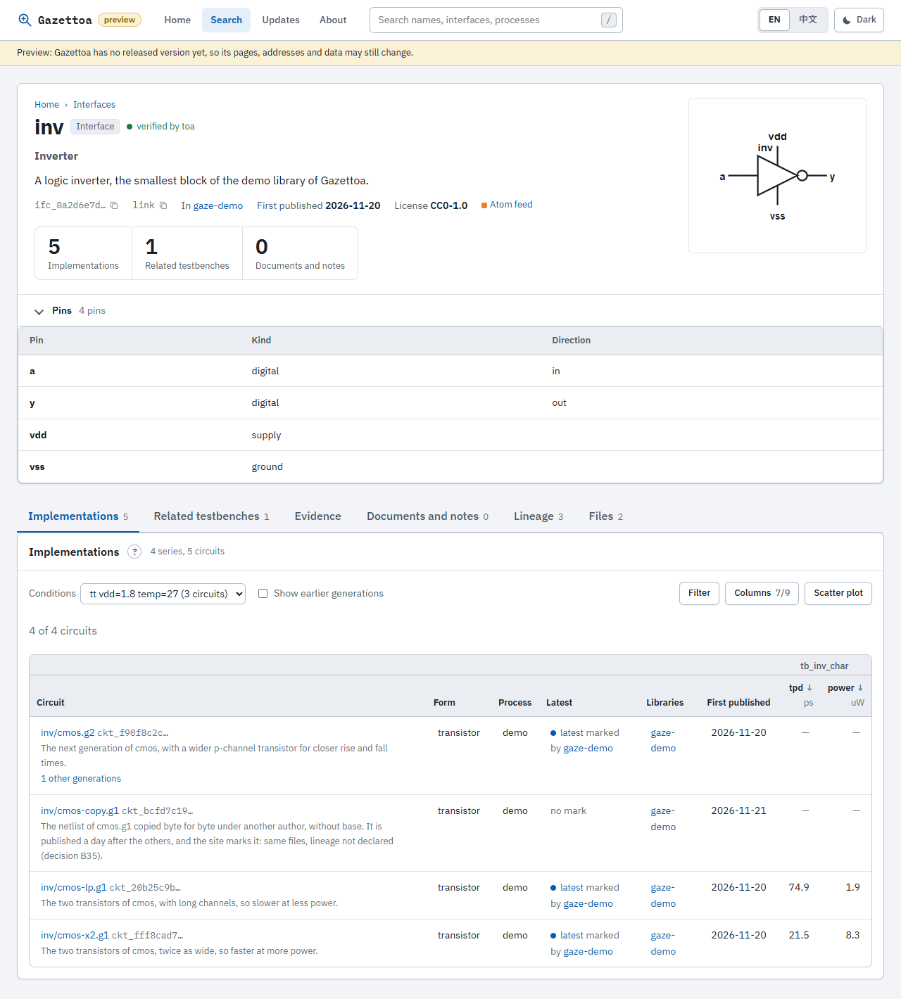
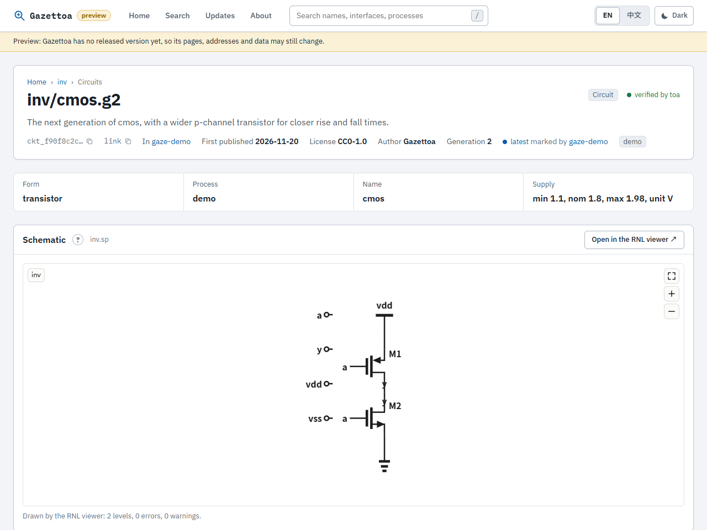

# Gazettoa

**The Gazetteer of TOA libraries.**

> **Preview.** Gazettoa has no released version yet: no version number, no tag, no release. Its
> pages, addresses and data may still change.

*Gazettoa (gazette + toa) is a read-only, static browser for TOA libraries.* Its short name is
`gaze`: the builder is the Python package `gaze`, its settings are `gaze.yaml`, and the files of this
repository use that name.

TOA (True-OpenAccess) is a format for libraries of circuit designs: every object is named by the
hash of its files, refers to others by name, and stays in the library where its authors published
it. Gazettoa reads a list of such libraries and builds a static site from them: interfaces with
their circuits, testbenches, evidence records and documents, and frozen libraries; where each
object is published, and which libraries mark it latest; its lineage and generation;
reproduction groups, multi-party verification and results that disagree; and, for each
interface, one table of its circuits with what their records measured, and a scatter plot.

It stores no object. Only the reference tool `toa` reads libraries: `toa index` fetches them,
checks every object from its files and writes an index; the builder of Gazettoa turns that index
into the site's data. The pages fetch files from each library at the commit that was read, and
check each file against the SHA-256 the index recorded. Netlists are drawn by the RNL viewer,
embedded; the symbol of each interface is drawn at build time by `rnl`.

For readers who follow it there are Atom feeds; for agents, `llms.txt`, a page `#/agent`, and the
instance as a TOA source list (`registry/instance.source.jsonl`) that `toa` can include.

It takes no submissions and keeps no record of its own. When a library removes an object, the site
drops it at the next build and notes that it left; a removal record the library wrote is shown as
the library wrote it.

## Screenshots

The home page of this instance, and the symbols of its interfaces:





An interface of the demo library (`scripts/demo/`): its symbol and pins, and one table of its
circuits with what their evidence records measured:



A circuit, its schematic drawn by the RNL viewer from the netlist:



## What is here

| Path | What |
|---|---|
| `instance/` | The instance this repository publishes: `workspace.source.jsonl`, the libraries it includes (a TOA workspace list), and `gaze.yaml`, its settings |
| `builder/gaze/` | The builder, Python 3.10 or later, standard library only |
| `web/` | The page shell: `index.html` and plain ES modules, no build step; `fonts/`, the fonts the site ships, with their licences |
| `i18n/` | The languages of the interface; catalogs keyed by the English text |
| `tests/` | Tests of the builder and of the text given to the RNL viewer; `tests/data/` holds an index `toa` wrote for its small examples |
| `scripts/` | `examples.py`, a preview from toa's examples and a demo library; `serve.py`, the server for a preview; `i18n_keys.py`, the state of each catalog; `fonts.py`, how `web/fonts/` was made; `install-tool.sh`, how the workflows install `rnl`; `demo/`, the drafts of the demo library |
| `.github/workflows/` | `gaze-ci.yml`, the tests; `gaze-pages.yml`, the site of this instance on GitHub Pages |

## Build a site

You need `toa` (the reference tool of TOA, from <https://github.com/true-openaccess/toa>) and
Python 3.10 or later; `rnl` (the RNL command, 0.6 or later) to draw the symbols of interfaces, else
each is drawn as a box with its pins.

```sh
toa index --workspace instance/workspace.source.jsonl --out .work/index
cd builder
python -m gaze build --instance ../instance --index ../.work/index --out ../_site
python -m http.server 47950 --directory ../_site
```

- `toa index` never asks anything. It connects to the hosts written in the workspace list; exit
  code 4 means some library could not be fetched (the index is still written, and the site shows
  that library as an earlier build read it); 3 means it could not run.
- Keep `.work/index` and `_site` between builds: `toa index` then reads only new commits, and the
  builder reuses the files it copied before.
- Files are fetched by the page from github.com, gitlab.com and codeberg.org at the commit read,
  from any library that holds the object (the reader chooses). Libraries elsewhere, on this
  machine only, or set to `raw: copy` in `gaze.yaml` have their files copied into the site with
  `toa fetch` (`--toa` names the executable). `--copy-raw` copies every object, for a private
  instance or a preview without network.
- `--local-files DIR` (repeatable) is for a preview on this machine: the page reads the files of
  library `<key>` from `DIR/<key>/` in place, through `scripts/serve.py`; nothing is copied.
- `--rnl` names the `rnl` executable (default: on PATH). A symbol drawn once is reused.
- `--site-url` is the published address; feeds are written only when it is known.

A preview from the small examples of toa and a drawing demo, with the source of toa checked out
beside this repository (as `../toa`; `--toa-src` names another place):

```sh
python scripts/examples.py      # example repositories, the demo library, their index, and _site/
python scripts/serve.py --local-files ../toa/examples --local-files .work/examples/demo
```

The examples of toa have no symbols and no RNL drawings; `scripts/demo/` holds the drafts of a
small library that has both (two interfaces with `symbol.rnl`, circuits with drawings, two
generations of one of them, and a frozen library), which `examples.py` seals and publishes with
`toa` into a repository of its own.

Tests: `python -m unittest discover -s tests` (from the root of this repository); with `node` on
PATH it also runs `tests/viewer_text.test.mjs`, and with `rnl` on PATH it draws a symbol. None
needs `toa`.

## Run your own instance

Anyone can run an instance for their own libraries, public or private. Nothing in the code names
the official instance: the title, the address and the libraries come from `instance/`, and the
rest from the environment of GitHub Actions.

1. Fork this repository.
2. Replace `instance/workspace.source.jsonl` with your libraries, one include line each:

   ```json
   {"toa": "source/1"}
   {"include": "library.source.jsonl", "group": "mylib", "branch": "main", "sources": [{"git": "https://github.com/me/mylib"}]}
   ```

   `group` is the library's short name on the site; `branch` is the branch the library publishes
   on (default `main`). The include lines inside each library's own list are not followed: the
   instance includes exactly what this file lists.
3. Edit `instance/gaze.yaml`: at least `title`. Leave `site_url` out on GitHub Pages; it is taken
   from the repository (`https://<owner>.github.io/<repository>/`).
4. Turn on GitHub Pages with "GitHub Actions" as the source (Settings › Pages › Source). See
   [Publish with GitHub Pages](#publish-with-github-pages).

`gaze.yaml` is read without a YAML library, so it keeps to a small part of YAML: mappings nested by
spaces, `key: value`, one-line `{a: b}` mappings and `#` comments. Its keys:

| Key | Meaning |
|---|---|
| `schema` | `gaze/instance/1` |
| `title`, `description` | Shown on the home page and in the title bar (the default title is Gazettoa) |
| `site_url` | The published address, for feeds and `llms.txt`; default from GitHub Actions |
| `viewer_url` | The RNL viewer embedded for schematics; the page sends it the netlist as text |
| `hosts.<host>.raw`, `.web` | How a file and a folder of a library on another host are addressed: `{repo}`, `{commit}`, `{path}` |
| `libraries.<key>.raw` | `url` (the page fetches files from the host, the default) or `copy` (the build copies them) |

## Publish with GitHub Pages

`gaze-pages.yml` builds the site every 30 minutes, by hand, and when the instance or the site's
code changes, and publishes it with GitHub Pages. It needs no secret, names no organisation, and
the site's address comes from GitHub Pages, so a fork runs it unchanged.

- **toa** has no release yet, so the workflow builds it from its source: the repository in
  `TOA_REPO` at the commit in `TOA_COMMIT` (a full commit id), with the Rust version in
  `TOA_RUST` (`cargo build --release --locked -p toa-cli`). The executable is kept in the Actions
  cache under that commit and Rust version, so it is built once. Until `TOA_COMMIT` is set, the
  build stops at that step.
- **rnl** is installed from a release of the RNL core, pinned by its SHA-256 (`RNL_URL`,
  `RNL_SHA256`).
- Each run keeps the index, the site and toa's cache in the Actions cache, so only what changed is
  read again. When the cache is gone, the records the site keeps from build to build (when it
  first saw each object, objects that left a library, what Software Heritage archived, what GitHub
  said of signed commits) are taken back from the published site.

## What the build writes

| Path | What |
|---|---|
| `index.html`, `assets/`, `i18n/` | The page shell |
| `data/` | `site.json`, `search.json`, `changes.json`, one file per object (`obj/`), interface (`ifc/`) and library (`lib/`) |
| `sym/<hh>/<name>.svg` | The symbol of each interface: from its `symbol.rnl`, drawn by `rnl`, or a box from its pins |
| `feeds/` | Atom: `all.xml`, `ifcs.xml`, `ifc/<name>.xml`, `lib/<key>.xml` (only with a site address) |
| `llms.txt` | For agents: what the site is, where its data is, how to fetch objects with `toa` |
| `registry/` | `instance.source.jsonl`, every object with its git sources (a TOA source list); `workspace.source.jsonl`, the list the site was built from |
| `raw/<name>/` | Copies of objects' files, only for libraries read by copy |

## Status

A preview. The site is built from the index of `toa` and shows libraries, interfaces with their
symbols and a table of their circuits, objects of the six types (`ifc`, `ckt`, `tb`, `evd`, `doc`,
`lib`), latest marks, files checked against the index, schematics, lineage, reproduction groups,
removals, search, feeds, `llms.txt`, English and Chinese. It reads format 2 of the index of `toa`,
and shows the evidence of authorship and time that the index gives: when this site first saw an
object, objects with the same files, signed commits, timestamp proofs and Software Heritage (TOA
4.3, 6.3, 8.3 and chapter 11). Every page says that it is a preview.

## License

Code MIT (`LICENSE`). The theme tokens in `web/assets/tokens.css` are copied from the TOA project
site. The fonts in `web/fonts/` (IBM Plex Sans and Mono, Noto Sans SC) are under the SIL Open Font
License 1.1, each with its licence beside it. Objects shown by an instance are their authors', each
under its own license.
